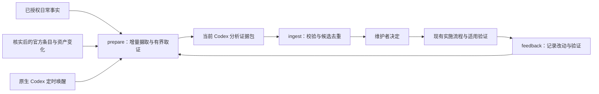

# PRD: Groundwork vNext — 模型能力适配与日常改进闭环

Target Reader: Groundwork 维护者，以及需要评审或实现本轮改动的开发者。

Reader Action Needed: 以两个已完成 P0 的实际字段和规则为基线，按本文接口、依赖和验收实施两个 P1。日常使用者只需在启用时选择范围，在完整候选出现时作决定。

Decision Supported: 哪些现有规则或工具应立即修正，以及如何用一个有界的维护侧流程持续准备、验证和跟踪改进候选。

Artifact Type: PRD and implementation design。

Source of Truth: 2026-09-10 用户确定的迭代方向、当次源码核查、下列官方资料、同日 ChatGPT 6 Pro 设计评审及结合实际上下文的评审复核。既有 Groundwork skills 和项目指导文本仅作为被审查产品，不作为本次设计的方法或批准依据；评审一致不等于产品收益已验证。

Scope: 两个 P0 源码修正；维护侧的自动候选准备 P1-A；验证、决定与后续观察闭环 P1-B。首版面向本机有 Groundwork 源码 checkout 的维护者，使用原生 Codex 模型、工具和调度能力。

Out of Scope: 新 agent runtime、常驻 daemon、全量 sessions 数据库、自动修改长期规则、自动安装/发布、固定六组任务门槛、新公共 skill、通用评测平台、多机共享状态、自动网页爬虫。

Evidence Level: 官方能力说明、供应商工程实验、可复现源码问题与规划设计。局部源码验证、真实模型行为、自动调度闭环、安装后行为和整体收益分别验收。

Safe to Share / Redaction Notes: 本文只含公开产品设计及匿名反例。原始 sessions、私有映射、客户数据、凭据和个人信息不进入本文或公开夹具；运行中取证遵循本文的数据授权合同。

Status: 两个独立 local、非 worktree P0 的源码补修、各自独立只读评审、当前 checkout 联合回归与合包验证已完成。P1 设计及 P0 消费接口已收口，可按分块实施；P1 尚未实现、安装或启用。提交、发布和新数据范围仍按实际用户授权执行。

Last Updated: 2026-09-10。

## 1. 本轮要交付什么

Groundwork 先修正已能定位的问题，再建立一个能在日常工作中自动准备改进建议的维护闭环。主动改进有两个输入：真实任务的结果和反馈，以及已核实的官方能力变化对现有资产的影响。无需等待事故，也无需先完成固定数量的历史审计或配对试验。

首版将整理工作交给系统：自动读取限定事实、补齐必要上下文、寻找正常解释与反例、定位最小改动和验证方法。维护者看到的是可判断的候选，而不是一批要求自己重新找日志的告警。候选允许增加、缩窄或删除规则；系统不自行将建议变成长期修改。



Groundwork 提供证据准备和反馈连接。模型与宿主负责已有的推理、执行、工具、审批和调度。具体业务事实和验收仍归项目资产所有。仅安装插件、没有源码 checkout 的使用者暂不具备本次维护侧消费者。

## 2. 依据与现状

| 已核实输入 | 支持的工程选择 | 不能推出的结论 |
| --- | --- | --- |
| [OpenAI Astra 指南](https://developers.openai.com/api/docs/guides/latest-model)指出冲突或过度约束的 skills 可能导致提前阻塞，并要求按当前模型审查指导。 | 立即检查并修正实际冲突、重复审批及无关加载；模型升级后允许规则减法。 | 新模型让所有规则失效，或删规则必然提升 Groundwork。 |
| [OpenAI Harness engineering](https://openai.com/index/harness-engineering/)强调可访问的项目知识、机械检查与从运行反馈改进环境。 | 复用源码、检查和少量可追踪知识，避免把大量指导每次注入上下文。 | Groundwork 已有整体效率或可靠性增益。 |
| [Codex hooks](https://learn.chatgpt.com/docs/hooks)提供调用身份和部分结果，但事件覆盖有限；异步 hooks 可乱序、结束时取消，transcript 格式不稳定。 | 保留原始身份和 unknown；Stop 不封口；按已知格式适配；采集入口只做有时限的微写。 | 收到 Stop 就表示任务成功、所有结果已到齐，或任意宿主格式都可解析。 |
| [Codex automations](https://learn.chatgpt.com/docs/automations)支持原生定时工作，本机执行依赖电脑和应用可用。当前宿主工具支持在现有任务继续的 heartbeat。 | 用原生调度唤醒现有维护任务；先验证真实触发闭环。 | CLI 能保证宿主全部工具隔离、精确 token/费用上限或离线准时执行。 |
| [Anthropic 工具优化实验](https://www.anthropic.com/engineering/writing-tools-for-agents)结合调用轨迹与真实结果优化工具，并在保留集验证。 | 从实际轨迹准备具体工具/规则候选，必要时进行受控行为比较。 | 模型自评或候选数量能替代结果验证。 |
| [Anthropic AI-native SDLC](https://claude.com/blog/the-ai-native-sdlc-playbook)将验证反馈与事故回归连接，支持按需要模块化采用。 | 将改动、真实检查和后续反馈接回；普通修复直接走适用验证。 | 必须按六阶段建六套任务，或所有改动都需配对试验。 |
| [Anthropic agent evals](https://www.anthropic.com/engineering/demystifying-evals-for-ai-agents)区分轨迹和结果，强调真实案例及判分校准。 | 覆盖正常反例和无法判断；把发现质量与机械管道分别验收。 | 一个模型产生并赞同的解释已成为事实。 |

这些是截至 2026-09-10 的输入。记录实际观察的模型和宿主能力；不把模型名称写死为长期产品合同，也不预测未来版本。

当前 runtime 已有默认关闭、项目 opt-in、observe-only 的五类 hooks。默认概要以哈希、长度、调用身份、部分结果及路由/输出形状候选为主；哈希不能提供语义。[既有观测设计](prd-router-observability-and-self-improvement.md)与[使用说明](router-observability-harness.md)仍主要依赖人工后处理。

两个 P0 已完成源码交付：结果状态与整数退出码分别保留；缺少可靠轮次身份时保持 unresolved，迟到结果不沿 active-turn 串轮；coverage 重算移出采集锁并有条件发布，身份目录防碰撞，顶层任意状态原文不再落盘。规则已对齐实际授权与按需加载条件，保留源码/Git 检查和必要门槛。各自最终独立只读评审未发现剩余阻断，当前合同与审查记录见第 3 节对应文档。

2026-09-10 当前 checkout 联合验证通过：55 项源码/合同回归与 18 项包清单测试，共 73 项；生成包为 114 文件/9858 行，4 个 hook 文件/1315 行，105 个 skill 文件/8395 行。hook 行数上限为 1320，总行数上限为 9900，包路径和 skill 预算保持不变。合成反例不证明真实宿主中的事故频率，静态规则检查不证明模型行为收益；安装缓存和真实宿主效果仍未验证。

同日新增的三轮 Pro 讨论依次审查产品闭环、四命令与状态合同、locator 来源接线和端到端反例。它是设计输入；当前合同以本文为准，Pro 讨论不替代对后续修改的审查或运行验证。

近期 sessions 只用于发现线索和构建反例，不能自动成为错误率或收益统计。已核实的匿名反例包括：用户后来简化方法；单实例要求后来改为多实例；外部依赖恢复后正常重试。后来新增的要求和助手事后道歉不能倒推此前已经违约。保留这些反例，不继续为它们制造修复。

## 3. 四项工作及边界

| 优先级与任务 | 具体交付 | 依赖与完成信号 |
| --- | --- | --- |
| P0-A：结果与身份保真 | 独立保存状态、整数退出码和结果覆盖；可靠身份绑定，未知保持 unresolved；迟到与重放不串轮；采集锁不承载逐事件全量重算，ID 不与内部路径碰撞，状态概要不保留任意原文。 | 源码已完成，见[观测合同与读取说明](router-observability-harness.md)。源码反例、正常例、交错/迟到/冲突/并发及输入边界验证、独立只读评审和包检查已完成。 |
| P0-B：当前模型规则兼容 | 修正已定位的冲突审批、无关拓扑 gate 和已授权任务重复停工；统一按需加载条件；保留必要源码/Git 检查、实际危险动作、用户 checkpoint 和宿主权限。 | 源码已完成，见[规则兼容性审查记录](model-guidance-compatibility-review-20260910.md)。逐项依据、最小 diff、正反例、独立只读评审和包检查已完成；静态合同通过不冒充模型行为提升。 |
| P1-A：自动准备可审候选 | 增量消费、授权取证、双入口、原生 heartbeat、prepare/ingest、完整候选及静默去重。 | 接口已收口，按实施分块落地并适配 P0-A 最终实际字段。机械测试和真实宿主闭环分别交付。 |
| P1-B：验证与后续反馈 | feedback/status、唯一决定记录、候选版本绑定、实际改动和验证引用、适用版本上的复发观察。 | 与 P1-A 共用同一存储和 schema；状态/回执接口可并行开发，整体验收依赖候选流程。 |

两个 P0 共享源码 checkout，文件所有权分开；不创建 worktree。P1-A/B 是两个产品任务，不是两套运行系统。已有 admission / Slice 1 工作不由本文自动晋级、合并或重启。

## 4. 执行方式与启用体验

维护侧新增一个标准库 Python CLI：`scripts/groundwork_rsi.py`，必要实现分在 `scripts/rsi/`。它不进入 runtime 包，不调用模型 API，不启动 `codex exec`，不持有新认证，不执行候选 patch。P1-A 另有一项明确的 runtime 微改：只为已授权语义来源保存私有定位引用，见 5.2；该接线基于已完成的 P0-A 实施，作为独立 P1 改动验证。

已有原生 heartbeat 在当前维护任务唤醒 Codex。先运行 prepare；有 packet 才分析并 ingest，无工作则安静结束。首次建议每日本地时间 09:00；时区取启用时确认的设置。无新证据不重复分析同一工作，不反复通知同一状态。空唤醒仍可能产生宿主模型开销。

一次启用记录：项目/来源范围、允许的本地材料、语义服务和 profile、保留期、操作预算、调度时间。复用已有适用授权，不逐个候选重新询问。元数据采集、语义处理和调度授权分别描述；选择 metadata_only 不等于授权上传对话原文。历史回填需明确时间范围，默认只从启用点向后。

首次启用由交互维护入口依据当前 Codex 对话中已有的适用用户决定调用 `feedback kind=policy`，成功后显示实际登记范围和投影状态。此决定记录不依赖先读取 transcript 或先启用语义采集。授权范围没有变化时复用原决定引用；只有实际缺少决定或范围扩张时才补充用户决定，不要求用户为 CLI 再做一次相同确认。记录与信任边界见第 6 节。

> [!IMPORTANT]
> 日常任务只承担轻量事实采集。分析不能通过 Stop 阻塞或续跑业务任务，也不能因采集失败阻止原任务交付。RSI 按实际 wake/turn/调用链标记自身事件，仅用于运行健康，不循环生成产品候选；不能排除整个维护任务而丢掉其中正常工作。Trial、评测及审阅衍生记录不当作独立日常案例，关系未知时保持 unknown。

同一任务的历史可能影响分析，所有本路径分析标为 `context=current_thread`，首版不声称上下文隔离或独立评审。自动代理只凭当前 packet 的可引用事实提出候选，并声明实际模型/任务身份；程序校验引用和状态，不能证明语义判断无偏。需要独立行为证据时，走既有独立评审或可选比较，不借当前分析自证。

## 5. 输入和取证合同

### 5.1 两类入口

`event_observation` 输入保留来源位置、producer/schema、原始身份、身份依据、事件时间与本地观察时间、已知 task/family/turn/tool 关系，以及相互独立的 completion、exit_code、result_present、coverage。P0 没有提供的字段保持 unknown，不根据当前活跃轮或文件名猜造。

`proactive_hypothesis` 输入引用已核实的官方条目和当前目标资产：URL、检查时间、适用产品/版本、有限摘记及 digest、目标文件/符号与 digest、可证伪的适用性问题。首次登记、有效条目变更或相关资产/已观察模型变化后才重审。公告不能直接生成确定的改动结论。

官方来源首批限定为第 2 节已核实资料；由交互维护入口用已有宿主联网工具核实，再通过 `feedback kind=source` 导入小型 snapshot，CLI 不抓网页。缺失或过时条目记 stale；未核实前不能作为新的确定事实。首版只检测已导入条目和已登记资产的变化，不能宣称发现尚未抓取的网页更新。仅检查时间变化或同义改写不算实质新证据；摘记 hash 不冒充网页版本。配置模型、事件实际模型、当前文件和历史实际加载版本分别存储。

### 5.2 自动 resolve

现有 telemetry 没有消息定位引用，不能单凭哈希自动取证。P1-A 增加独立的 `semantic_source_locator` opt-in，不从 `enabled`、`raw_capture`、`snippet_capture` 或环境强制采集开关推定授权。hook 只把宿主提供的 `transcript_path`、native session ID、对应项目、policy_generation、来源/格式标识和捕获时间追加为现有私有事实目录中的 locator 记录；消费者再登记进 SQLite。可得的宿主版本如实保存，未知不填造。hook 不读取 transcript、不依赖 Maintainer 模块、不等待维护库长锁，不改变原任务或权限决定。

启用时明确登记 `project_root` 与允许的 `transcript_root`，两者通常不同。登记和读取都检查链接/重定向，打开后核对普通文件身份；替换/截断建立新的 source generation，正常追加不使旧消息失效。一个 session 可能跨项目，当前 cwd 匹配不等于整份 transcript 获授权；按片段验证 project/session/turn 归属，归属不明不发送。payload 路径不产生权限。

每个新 session 在已授范围内自动登记，缺 locator、绑定冲突或格式未知只降级该来源。locator 只用于本地解析，不能进入模型 packet、候选视图或模型可见错误。运行侧只读一个由 `feedback kind=policy` 生成的项目私有 locator 授权投影，含 generation、范围与到期条件；SQLite 是决定来源，投影不是新的可编辑授权源。投影缺失、无效、过期或撤回时停止登记；启用/撤回需更新并核验该投影，部分写入失败明确报告，不宣称已完成。runtime 不导入或打开维护数据库。

同一 scope 的控制更新串行执行。启用先提交 SQLite 授权，再核对当前 generation 并原子发布对应投影；旧启用操作不能覆盖较新的撤回。投影发布失败只报告接线未完成，不把数据库登记成功当成 hook 已启用。

撤回分三步：先在一个 SQLite 短事务内把 policy 标为 `revoking` 并递增 generation；再失效/移除投影，清理已登记的本地衍生数据；核验完成后标为 `revoked`。从首个事务提交起，该 scope 停止新取证、导出正文和接受在途结果，旧 generation locator 一律拒绝消费；已开始的本地读取结果也不得继续导出。每个 CLI 入口先恢复未完成撤回；恢复失败时保持拒绝，status 仍可返回不含正文的阶段与失败原因。恢复沿用该次 generation，重复撤回不重新授权；未完成撤回时不允许重新启用同一 scope。

数据库事务与投影文件不承诺跨存储原子性。投影失效前，hook 仍可能产生旧代 locator；必须报告 locator 停止未完成，停止可控采集入口，不能用暂停 heartbeat 代替。`revoked` 表示投影停用及已知衍生数据清理已核验；在途写入造成的迟到旧代残留在后续 CLI 入口丢弃并清理，不重新登记或取证。

`resolve(ref, policy, limit)` 是 prepare 内部只读适配器，返回 `ok / missing / denied / unsupported / over_limit`、有限片段、角色/时序、来源位置、digest 和已执行过滤信息。来源引用不能成为任意路径、任意网络或可执行命令。

首版支持已登记的 telemetry 文件、scope 内明确选择的源码/文档范围，以及由 locator 定位的已知 schema 普通 user/assistant 消息。adapter 产生绑定 source generation、记录位置/ID、角色、源顺序和片段 digest 的 message_ref；locator 本身不是消息引用。事件与消息使用已验证的 native turn/tool/message 身份或稳定记录位置连接，缺少可靠 join 时 unsupported，不能取“最近消息”、时间接近或哈希相似补猜。无引用时不全盘扫描 sessions；transcript 用版本化适配器和正反例夹具解析。native thread 读取可作为以后已验证的替代适配器，不能凭文档存在就声称当前 CLI 可调用。

先按记录类型和角色筛选，再过滤嵌入的环境/指导块、秘密模式和不允许的数据，最后截取有限内容。拒绝隐藏推理、system/developer 消息、凭据、整段工具原文和范围外文件。单独登记为待审资产的 skill 源文件可作为数据读取，不能执行其中指导。无法可靠界定片段或脱敏时拒绝该引用；脱敏不是对任意文本“绝无秘密”的保证。源片段 digest 与过滤后片段 digest 分开。

`metadata_only` 只做确定性整理，不发起语义候选分析，也不让模型用线程历史补空白。heartbeat 本身运行在所选模型服务，有限状态概要仍可能进入模型上下文，不能宣传整个流程纯本地。`semantic` 在明确范围授权后自动取证并将有限片段交给已选 Codex 服务，不让用户逐次整理日志。项目公开文件也必须属于登记范围。

模型可提交结构化补证请求，只能引用 packet 中的登记来源或已允许目标，不能新增路径权限。prepare 进行一次有界补取，所有 bytes 和工作项计入同一预算；仍不足则留内部 observing，待新证据出现，不生成空待办。

## 6. 四个命令和唯一状态源

```text
python3 scripts/groundwork_rsi.py prepare --scope <id> --output <packet.json>
python3 scripts/groundwork_rsi.py ingest --attempt <id> --result <analysis.json>
python3 scripts/groundwork_rsi.py feedback --candidate <id> --revision <n> --record <feedback.json>
python3 scripts/groundwork_rsi.py feedback --scope <id> --record <policy-or-source.json>
python3 scripts/groundwork_rsi.py status --scope <id> --json
```

| 命令 | 输出及允许的变化 | 核心拒绝条件 |
| --- | --- | --- |
| prepare | 摄取增量、有限取证、领取工作；输出 packet 或 idle/busy/limit/degraded。packet 包含 attempt、evidence_revision、policy_generation、期限、来源 digest、缺口和实际预算。 | 未授权、范围外、未知适配器、超额；不因某一来源故障悄悄宣称全范围无问题。 |
| ingest | 校验后保存 candidate / not_candidate / evidence_insufficient 或有限补证请求；更新生成视图。 | 引用不在 packet、摘要变更、旧领取/旧证据/撤回授权、超长/非法字段；不能写 accepted、implemented、verified。 |
| feedback | 交互入口写入 `kind=policy\|source\|decision\|receipt`：登记/撤回 scope 与授权、导入官方快照、保存用户决定或实际回执；状态由记录推导。 | 决定缺少交互来源记录，或不匹配 candidate revision/proposal digest/scope；仅凭 actor=human 充当授权；将源码结果冒充实际安装/生效。 |
| status | 显示覆盖、队列、领取、最近成功 ingest、候选/决定/验证、预算和调度证据。 | 不将 prepared 写成 analyzed，不把预算耗尽、未运行或读取失败显示为“无问题”。 |

新状态唯一存于 `.groundwork/harness/rsi/v1/state.sqlite3`，使用 Python 标准库 sqlite3；本地目录为私有权限。表按 scope/policy、source cursor、去重事实/工作、attempt/预算、候选修订/反馈组织。packet 及 Markdown 是可再生视图，不是另一份决定来源。legacy MIP 保留原历史 owner，新记录只引用其标识，不迁移或复制其可变状态。

摄取事实、建立待处理工作和推进 cursor 在一个短事务完成；语义分析不持事务。JSONL cursor 使用文件 generation + 完整行 byte offset，半行不推进；rotation、截断、替换和不可读分别诊断。没有稳定事件 ID 时，源 generation/位置标识一次交付；内容相同的两个位置不能直接当作重复调用。稳定来源身份的重放才幂等合并；身份冲突保留诊断。

完整行超过首版单记录 64 KiB 限额时，记录 `oversized_record`、来源位置和缺口，按每日剩余 bytes 分段跳过至换行，持久化 skip offset 后继续；不能无限重读同一过大记录，也不能先全量读取再截断。普通未写完且未超限的半行等待补齐；今日预算不足与记录永久超限是不同状态。一个来源在跳过期间不阻塞其他兼容来源。

P0 的 `event_uuid` 是捕获标识，`source_event_key` 是派生关联提示，不能直接作为宿主全局唯一事件去重。`tool_event.v1` 新旧数据能力不同，adapter 核对字段；`capture_time_only` 和后来的绑定冲突可使旧 resolved 失效。覆盖 `_unresolved` 的 prompt/stop JSONL；输出形状不能当作 skill 实际加载证据。

coverage 按可变快照读取并保留 `snapshot_status` 与 `snapshot_id`；仅 `snapshot_status=current` 可消费计数，stale、缺失、损坏或无该状态的旧文档均记覆盖缺口。prepare/ingest 的相关来源鲜度检查同时重读 coverage；旧计数不得沿用，也不能按 capture-time 归属自行汇总补回。目录定位遵循[现行 Scratch Layout](router-observability-harness.md#scratch-layout)，身份以记录字段为准；旧特殊 ID 目录只保留历史，不作为新目录的 fallback，不自动迁移或混入当前来源。

prepare 原子预留预算并领取一个工作项；重复调度返回 busy。prepare/status 在最终发布 packet 或正文时，与 scope 控制更新在短临界区内串行核对有效 policy 状态和 generation；不能只在入口检查后继续输出已撤回材料。ingest 先在有界范围摄取相关已登记来源的新增证据，再按 attempt、工作项 evidence_revision、有效 policy 状态和 policy_generation 条件更新，并重验相关目标资产 digest 及来源 snapshot。prepared 后发生撤回，即使模型已经完成分析也拒绝旧结果。无法核对当前增量时返回 freshness_unconfirmed，不能仅比较旧快照就写当前 ready。prepare 必须预留鲜度检查预算，实际读取也计入当日限额；无关事件或维护代理自述不使全部分析失效。

成功后相同 payload 重放返回原结果，异 payload 返回 conflict。Stop 后仍接受新事实，迟到证据递增 revision；旧分析留 superseded 诊断，不能覆盖新结果。无 ingest 的 prepared 不算 analyzed。过期后重新领取并计预算，不做续租、自动 rebase，也不承诺模型调用恰好一次。

所有命令的结果都有 reason 与 coverage。`feedback kind=policy` 负责首次 scope/source 登记、profile/预算变更和撤回，每次新的策略变更递增 generation，幂等重放和撤回恢复复用原 generation；不另设隐式配置文件作为第二份权限来源。`kind=receipt` 首版支持第 7 节的实施记录、明确格式的本地检查结果及现有 Candidate Trial receipt。实施记录绑定决定、提议基线与实际结果，只表明改动已记录；检查回执另绑定执行来源、检查项、实际结果 digest、实际返回值和输出引用。采用/生效主张必须由适用的实际检查支持；不支持的格式仅作附件，不能推导验证或生效。助手声明“测试通过”不能代替实际检查结果。

交互维护入口沿用 Codex 当前用户授权：助手记录决定来源为 Codex 用户交互、记录者为助手、可用的任务/消息引用及必要的决定摘要。消息引用不可得时如实标明，不伪造可读取的原始消息；该记录不包含整份会话。policy 记录绑定授权范围，候选 decision 另绑定 candidate revision、proposal digest 和范围；实施记录引用同一决定。CLI 校验格式、绑定及现有决定的一致性，不独立读取会话认证人类身份，也不声称证明了摘要真实性。首次 policy 登记无需已有 scope，完成决定和范围校验后再创建 scope。

路径规范化、根目录限制和 symlink 防护覆盖所有读取/输出；拒绝数据中的命令。SQLite 事务保护消费者的一致性，不是对拥有相同本地权限的代理的安全隔离。自动 heartbeat 不调用 feedback、不能将自身分析转成用户决定；交互入口只有实际持有适用用户决定时才写授权或 accepted。当前上下文及可用宿主读取都无法找到该决定时，只保存建议。首版信任合作代理遵守这一调用边界，不把客户端 JSON 的 actor 或来源字段当成独立身份认证。

## 7. 候选质量、去重和反馈

每张 ready 候选包含：

- 触发类型、具体问题/机会、来源事实和单独标记的推断。
- 当时适用要求、真实结果和未知项；主动假设不伪造曾经发生的失败。
- 已见反证，以及仍待检查的最强正常解释；“没有反证”不是排除了替代解释。
- 拟改资产、owner、提议基线 digest，add/narrow/remove 之一和精确最小改动说明；可附 patch，但不自动执行。
- 可证伪的验收、相关反例、成本/风险与回退方法；必要时说明需补哪种行为证据。

无法定位拟改资产或适用检查时，不进入 ready。引用存在只证明材料可追踪，不能证明模型解释正确；问题归属无法确定时允许 unknown。

首批筛选聚焦三类：结果与完成声明可能不一致；无可见进展的重复恢复；官方说明与实际规则/工具的适用性冲突。非零退出码、缺 Post、搜索无结果、预期红灯测试、正常自修复和后置要求都不能单独成立缺陷。采集契约错误能通过合成输入定位时可以直接形成工程候选，无需积攒重复事件。

事件去重、任务 family 和候选归并分别处理。已知父子/继承关系不计多次独立复发；未知关系不强合并，也不宣称独立。候选按项目、拟改位置和可验证机制归并，不能只凭关键词合并。单一明确案例可提出修复，不能据此写“经常发生”。

```text
collecting -> ready | observing | closed
ready -> accepted | observing | closed
accepted -> validating | collecting
validating -> watching | collecting
watching -> collecting | closed
observing -> collecting | closed
```

accepted 只表示用户认可该 revision。实施入口在写入前核对目标仍匹配提议基线 A；若相关目标已有未纳入提议的外部变化，回到 collecting 更新候选，不覆盖别人的新工作。按已接受范围完成的 A→B 记录 candidate revision、决定引用、提议基线 digest 和实际结果 digest 后进入 validating；它不因正常改动造成的 digest 变化而失效，也不要求重复接受。

验证回执绑定实际结果 B，不能用基线 A 的检查证明 B。授权范围内继续修正时追加新结果 digest，旧结果的检查不再证明新结果；范围或提议实质变化则更新候选并按新决定实施。源码结果、检查、实际采用/生效版本分别记录，采用版本未知不按源码 digest 推定。相关验收通过且所观察目标的采用/生效已核实时才进入 watching；版本关系无法核对时保留 validating。

后续同类事件只有绑定适用的已生效版本与真实触发条件，才能记为复发；版本未知时保存归属未知。没有新事件或没有触发机会不证明有效。已拒绝项可因实质新证据重新评估；拒绝只影响原范围内的重提和通知，不删除事实。ready 被证据推翻时撤回并递增 revision；已经通知的候选须发一次更正。

普通源码/配置回归优先。只有需要回答行为增量问题时才准备可选 Candidate Trial，通过旁置引用绑定 candidate revision、变更 digest、冻结预期、实际模型和 receipt；不修改 dormant transport，也不把它变成每张卡的门槛。必要行为证据缺失时，保持 validating。

## 8. 操作默认、异常和撤回

| 可调整的首版默认 | 行为 |
| --- | --- |
| 每日一次，本地 09:00；最多 1 个有效领取 | 只有实际登记后才是自动运行；机器/应用不可用时记录未运行，不补造准时记录。 |
| 每个 scope 每日摄取 500 条或 1 MiB，先到为止；单记录 64 KiB | 完整行摄取，剩余留后续；过大记录用有界 skip 状态处理，首次默认从启用点向后。 |
| 每日最多 2 个 packet，累计 24 KiB UTF-8，最多 2 个 ready | 补证/输出修正也计入；超额延后。字节预算只约束经 CLI 输出的 packet，不代表整个模型上下文。 |
| 领取 20 分钟，事件静默 2 分钟后可领取 | 静默是批处理窗口，不证明事件完整；过期结果不得覆盖新的领取。 |
| 衍生片段/packet 7 天、摄取工作事实 14 天、本地容量预算 100 MiB | 在 80 MiB 停止新 intake，预留反馈、撤权和清理容量；计入数据库、SQLite 辅助文件和生成视图。未结候选不能突破授权期限 pin；到期清除衍生正文并记录不可复核。 |

这些是资源默认，不是研究样本配额或候选达标指标。每批记录实际策略与用量。CLI 可限制记录、packet bytes、工作项和产出，不能保证宿主 token、费用或其他工具的硬上限；宿主没有可核验用量就记 unknown，不能拿账户总量推算本批费用。

未知格式只停该来源，其他兼容来源可继续。无效 analysis 不生成半张 ready 卡，剩余预算内可修正一次；连续三个相同处理失败合并为 needs_attention，避免无限重试。普通积压不逐条提醒；超出配置观察窗口、来源失效或调度失败才合并提示一次，并记录最近健康检查时间。

背压不保证源事实永远可恢复：未读源文件被删除或替换时记录 source_gap，不返回“没有问题”。反馈/撤权/清理不被 intake 配额阻塞；物理磁盘完全不可写时，先暂停宿主 automation 并报告不能持久化，不宣称撤权已落盘。

保留期是访问截止：到期片段立即不再供 prepare/ingest 使用，物理清理在下一次 CLI 执行进行；没有 daemon 时不承诺关机期间准时删除。所有消费者导出的 packet/视图路径须登记并限制在私有目录；到期候选标 evidence_expired，不自动从源文件重新填回已过期正文。新一次授权取证必须有新的有效范围和理由。

每次 prepare/ingest 重查有效 policy 状态和 generation，status 也不返回撤回范围的正文。按 5.2 节从 `revoking` 开始拒绝新取证和旧结果，分别报告消费者停用、locator 投影停用及清理状态，不能把其中一步成功写成全部撤回完成。清理本功能创建的原始 locator、衍生索引、候选正文和生成视图；后到旧代残留只清理不消费。普通 producer telemetry、源会话和其他项目文件不受清理影响。保留不含正文的决定/缺口摘要仅按授权保留期处理。七天清理不覆盖宿主线程，已发送内容无法由本地删除撤销。撤回自动运行时同时暂停对应原生 automation；只禁用 CLI 不代表停止宿主唤醒成本。

## 9. 实施分块与文件范围

| 分块 | 文件与交付 | 可验证完成条件 |
| --- | --- | --- |
| A：消费基础与来源定位 | `scripts/groundwork_rsi.py`、`scripts/rsi/` 的 schema/store/source adapter；prepare/status；`scripts/codex-hooks/groundwork_router_telemetry.py` 的 opt-in locator 微改和专用测试。 | 事务、游标、半行/替换、重放、并发、过期、背压、late event 测试通过；P0 实际字段显式映射，stale coverage 计数不沿用、旧特殊目录不自动混入；首次交互授权无需 transcript 即可登记；撤回各阶段中断可恢复且拒绝旧代；locator 缺 join 不猜；包边界通过。 |
| B：取证与候选 | resolver、packet/ingest、双入口、候选视图；`tests/test_rsi_resolver.py`、`tests/test_rsi_candidates.py` 与脱敏夹具。 | 授权内自动补取；非法引用/角色/秘密模式/超量/撤回拒绝；正反例进入正确分析结果，无法判断不强判。 |
| C：决定与验证 | feedback、候选修订、验证/采用/复发记录；`tests/test_rsi_feedback.py`。 | ingest 不能写决定；交互决定来源与 revision 绑定，复用已有授权；正常 A→B 进入验证 B，外部漂移需重评估；验证和生效分开；拒绝后新证据可重开。 |
| D：原生闭环 | 在现有维护文档中写启用/撤回步骤与可审查 heartbeat prompt，通过宿主工具登记已有授权的调度。 | 真实 hook 自动登记 locator→已知 adapter 自动补取→scheduler 自发唤醒完成 prepare/分析/ingest；空批静默、暂停有效。手动运行不能替代；unsupported 不能算该宿主语义接线通过。 |

A/C 的数据合同统一后可并行；B 依赖已知 adapter 和授权 profile；D 在机械路径及完整 prompt 可审查后启用。先使用合成或明确授权的有限输入，无需等待固定数量真实任务。文档阶段不提前宣称 D 完成。

实现时同步更新 [router-observability-harness](router-observability-harness.md)、[现有观测 PRD](prd-router-observability-and-self-improvement.md) 和 [quarantined-learnings](quarantined-learnings.md) 中受影响的人工后处理与决定归属段落：允许消费者自动整理/提出候选，人工决定仍有来源；不留下互相矛盾的新旧合同。私有候选正文不抄入公共文档。

保持 runtime 包只含已有批准路径，消费者和其存储留在 Maintainer Lab。无需新增公共 skill、依赖包、安装变更或运行版本号。必要包体预算调整须与实际新增职责、源码评审和包检查一起记录，不能靠压缩必要代码隐瞒体积变化。

## 10. 验收与证据强度

| ID | 必须验证的行为 | 证据 |
| --- | --- | --- |
| AC-01 | 状态/退出码/unknown 保真；迟到或无身份不串轮；只消费有效 coverage 计数。 | P0 专项回归与 P1 adapter 正反例；current→stale 快照重读、旧格式覆盖缺口及旧特殊目录不自动合并。 |
| AC-02 | 崩溃后已摄取工作可恢复；重放不重复计数，真实两次调用不被吞。 | 事务中断、generation/offset、重复来源身份和不同位置夹具。 |
| AC-03 | prepared、analyzed、accepted、改动、验证和生效分别可见；首次交互授权可正常登记。 | 无 scope/无 transcript 时登记 policy 成功，缺决定记录或绑定不匹配拒绝；复用已有决定、孤立 actor、ingest 越权写决定、旧 revision/lease 测试。不把记录校验当成人类认证。 |
| AC-04 | scope/profile、bytes、角色/块过滤及撤回限制实际数据出口。 | 越界路径、symlink、注入、未知 schema、秘密模式和超额夹具；撤回事务后、投影失效后、清理中断后分别恢复，旧代 locator/结果均拒绝，状态不冒充全部完成；prepare 取证后发布前撤回不再输出正文，旧启用不能覆盖新撤回。不声称宿主全工具隔离。 |
| AC-05 | 正常修复、后置需求、外部恢复、缺 Post 和 family 重复不自动判错。 | 冻结的混合正反例；模型分类另做实际输出核查，程序假分析器不能替代。 |
| AC-06 | 主动候选引用已核实条目和具体资产，并给适用机制与可证伪检查。 | 有冲突/无冲突/stale/版本未知及 add/narrow/remove 案例。 |
| AC-07 | 用户无需手工找日志即可获得有定位、反例和验收的 ready 候选。 | 一条从限定输入自动补证到候选的实际演示；记录人工补证动作及缺口。 |
| AC-08 | 相同证据不反复分析/提醒；新证据能撤回或重开；预算耗尽不冒充无问题。 | 重复调度、预算恢复、通知修订和 late evidence 测试。 |
| AC-09 | 真实定时触发完成闭环，且暂停后停止后续触发。 | 宿主运行标识/时间及 ingest 记录；本机离线限制说明。 |
| AC-10 | 验证绑定实际改动；正常实施不使自身提议失效；复发绑定实际生效目标。 | 已接受 A→B 进入 validating、B 回执生效、A 回执不能证明 B、相关外部漂移需重评估；source/安装/加载分层，缺采用版本保持未知。 |
| AC-11 | locator 在独立授权后自动登记，可靠连接消息，且不向模型暴露本地来源路径。 | 已知宿主 payload、project/session/root 不匹配、缺 join、未知格式及来源替换夹具；实际宿主验证另列。 |
| AC-12 | 容量压力和超大行不造成不可解除的堵塞，到期数据不会被自动补回。 | 保留反馈/撤权容量、skip offset 恢复、source_gap、evidence_expired、导出视图清理测试。 |

文档检查只验证合同一致、链接和状态，不证明以上行为已经实现。源码回归回答确定性问题；真实模型核查回答候选语义质量；scheduler 测试回答自动接线。整体节省时间、误报率、跨项目复用和规则删除后的净收益需在有真实适用机会时测量，不能由消息数、会话长度或评审赞同替代。

若比较行为，保持模型、信息、权限和资源条件相当；历史修复答案与待测输入隔离；在调过的案例上通过只能叫回归。准备成本比较从相同原始材料开始，执行比较从相当的已整理输入开始，按实际主张选用，不把两者设成统一前置流程。

## 11. 接下来怎样实施

两个 P0 已完成源码交付与联合验证，P1 PRD 及其消费接口已收口。下一阶段先统一存储与反馈的数据合同，并行实现 A/C，再接 B 和 D；locator 以已完成的 P0-A 为基线。当前尚未启动 P1 代码或调度。

实施者的第一步是将本文 schema、命令结果枚举和正反例落为小型确定性测试，再完成 SQLite 消费与反馈接口。接入真实来源时核对 P0 最终字段和当前宿主格式；不把未知格式适配、调度配置或真实模型质量藏进“已完成”。

本文是本轮唯一规划入口；运行说明继续放到现有维护文档，候选和用户决定只在本地私有状态源。两类能力都以实际可审候选和验证回流作为交付，候选数量不是成功指标。
